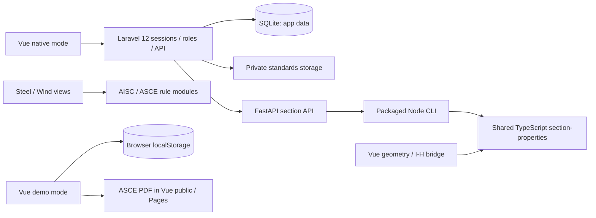

# Actual architecture

Audited `main` at `991342d`, 2026-10-16. Implementation facts below describe that baseline; PR proposals are separated at the end. Paths are relative to the repository root unless linked otherwise.

## Runtime and ownership

The ASCE original is also tracked at `frontend/vue/public/standards/asce7-10.pdf` and generated `docs/standards/asce7-10.pdf`: both are the same 658-page, 23,740,317-byte artifact, SHA-256 `ae2997f7a31975965b33065ba54acbf4da441f4f821b2a97372d67c2bd1ca248`. The [source-corpus documentation](../structural-platform/standards/ASCE7-10-SOURCE-CORPUS.md) explicitly describes this static distribution. Laravel authentication protects backend storage/endpoints; it cannot protect an already public static copy. Source visibility policy is a follow-up decision, not a private-only architecture claim.

The Python analytical solver is a separate verification oracle. It does not replace the Node core when production calculation fails. The design-rule modules consume geometry but do not belong inside the generic section solver.

[Compose](../structural-platform/compose.yaml) has `section-engine`, `backend`, `frontend`. It exposes frontend/backend on loopback and keeps engine port 8001 internal. Default Laravel database is SQLite in `backend/laravel/database/database.sqlite`, persisted through the project bind mount. No PostgreSQL service exists in main's default Compose.

PHP constraint is `^8.2`, Laravel `^12.0`, Composer platform PHP 8.3 ([manifest](../structural-platform/backend/laravel/composer.json)). Frontend is Vue 3/Vite/TypeScript with Node 24 in build/runtime scripts. Python package requires >=3.11; engine Docker pins Python 3.12 and Node 24. Read lockfiles rather than substituting latest toolchains.

## Laravel entrypoints and boundaries

[API routes](../structural-platform/backend/laravel/routes/api.php) use `web` session/CSRF middleware, then `auth` and, for mutation, `admin` as appropriate. [Bootstrap](../structural-platform/backend/laravel/bootstrap/app.php) returns API JSON errors for guests. There is no Sanctum/bearer or public registration flow.

| Responsibility | Existing implementation | Important contract |
| --- | --- | --- |
| Login/account roles | [AuthController](../structural-platform/backend/laravel/app/Http/Controllers/AuthController.php), [RequireAdmin](../structural-platform/backend/laravel/app/Http/Middleware/RequireAdmin.php), [UserAdminController](../structural-platform/backend/laravel/app/Http/Controllers/UserAdminController.php) | Server roles; last-admin/self-demotion protections; CLI/admin account creation |
| Global catalog CRUD | [LibraryController](../structural-platform/backend/laravel/app/Http/Controllers/LibraryController.php), `Material`, `SectionType`, `Section` | Authenticated read; admin write; reference checks |
| Library transfer | [LibraryTransferController](../structural-platform/backend/laravel/app/Http/Controllers/LibraryTransferController.php) | Stable codes, transactional import, no trusted imported snapshots or implicit deletion |
| Projects/options | [EngineeringController](../structural-platform/backend/laravel/app/Http/Controllers/EngineeringController.php) | GET/POST; user ownership; admin sees all; translated catalog codes |
| Section calculation | [SectionalCalculationController](../structural-platform/backend/laravel/app/Http/Controllers/SectionalCalculationController.php), [SectionPropertyCalculator](../structural-platform/backend/laravel/app/Services/SectionPropertyCalculator.php) | FastAPI proxy, strict result validation, no-write on failure |
| Combo workspace | [ComboGeneratorWorkspaceController](../structural-platform/backend/laravel/app/Http/Controllers/ComboGeneratorWorkspaceController.php) | One validated payload per authenticated user; explicit save/restore |
| Standards/corpus | [StandardsController](../structural-platform/backend/laravel/app/Http/Controllers/StandardsController.php), `ImportStandardPdf`, `ImportStandardsOutline`, `ImportStandardCorpus` commands | Private authenticated artifacts; candidates remain unapproved |

Routes are mixed: `/api/materials`, `/api/section-types`, `/api/sections`, `/api/library/schema`, `/api/projects`; calculation/workspace/standards use `/api/v1/...`. `/api/health` checks DB connectivity, not end-to-end solver readiness. Do not infer a clean layered-domain framework that this repo does not yet implement.

## Actual data model

| Entities | Ownership / relations / persistence |
| --- | --- |
| `users` | Global `role` admin/user; no organization/project membership table |
| `locales`, `catalog_options`, `catalog_option_translations` | Project dropdown codes and VI/EN labels |
| `projects` | Nullable `user_id`; catalog-option FKs; shallow project record, no project-section/workspace relation |
| `materials`, `section_types`, `sections` | Global library; sections FK to material/type; bilingual names and source metadata |
| `sections.section_properties` | Nullable calculated snapshot plus timestamp; `properties` remains dimensions/legacy input data |
| `library_seed_state` | One-time seed marker preserving CRUD edits/deletions across restarts |
| `combo_generator_workspaces` | Unique `user_id`, JSON payload stored as long text |
| `standard_families/editions/documents/clauses/equations/notes` | Source-aware registry; main does not yet expose a complete reviewed-rule workflow |
| `standard_source_pages/items` | ASCE private page/OCR/text/image/token corpus and candidate occurrences |

Source of truth: [migrations](../structural-platform/backend/laravel/database/migrations) and controller validation, not older conversational schemas. Main does not have `section_definitions`, immutable `section_revisions`, `section_property_sets` or a calculation-run reference graph.

Catalog writes compute before committing, then recheck linked references in a transaction. `SectionPropertyCalculator::validResult` checks canonical geometry/units/versions, required properties and formula-manifest integrity. Unavailable/invalid responses produce 503 without saving. [Section](../structural-platform/backend/laravel/app/Models/Section.php) exposes the saved report and mechanics. GET preserves snapshots/legacy values rather than rerunning a new solver. Server-side library import ignores supplied calculated snapshots.

## Geometry versus design

[Shared package](../structural-platform/section-properties/README.md): `index.ts`, registry, calculator, mechanics and formula-report helpers. Ten UI profiles over nine types; symmetric/asymmetric I share a model. Internal length mm, canonical XY; A in mm², I/J in mm⁴, S/Z in mm³, Cw in mm⁶. Material-dependent strengths/code classifications are outside this layer.

[FastAPI](../structural-platform/engineering/structural_engine/sectional_properties/api/main.py) calls [canonical bridge](../structural-platform/engineering/structural_engine/sectional_properties/canonical.py), which executes the packaged Node CLI. Python `solver.py`/`torsion.py` serve independent tests. Laravel tests often fake engine HTTP; actual image/API validation is separate evidence.

AISC [rule audit](../structural-platform/standards/AISC360-10-IH-PHASE-A-B-AUDIT.md) separates the 360-05 legacy workbook reference from the partial 360-10 kernel. F4/D/G/C coverage is incomplete; global `REVIEW_REQUIRED` remains. ASCE [wind audit](../structural-platform/standards/ASCE7-10-WIND-AUDIT.md) defines Ch27 Phase A and rejects unsupported scope. Never infer whole-standard approval from file names or a calculated branch.

## Frontend, demo and exchange

[App](../structural-platform/frontend/vue/src/App.vue), [modules](../structural-platform/frontend/vue/src/modules.js), ModuleHub and LibraryBrowser define the existing UI. [api.js](../structural-platform/frontend/vue/src/api.js) owns native session requests; [demo-api.js](../structural-platform/frontend/vue/src/demo-api.js) is localStorage-only. Standalone tools in `frontend/vue/public` are real source files; root `docs/` contains generated deployed copies.

Combo Generator embeds `combo-generator-v5.html` through `ComboGeneratorView.vue`, with explicit postMessage/JSON save and [per-user workspace](../structural-platform/frontend/vue/COMBO-GENERATOR.md). Its S2K exporter creates new-model load patterns/cases/combos. It does not modify object loads or read a running CSI model. [CSI agent](../structural-platform/csi-agent/main.py) and adapter directories are scaffold only. No workbook binary is tracked at this baseline; workbook parity requires the actual authorized artifact.

## Pending integration, not baseline facts

- [PR #19](https://github.com/DucVu89260/GeekCalculus/pull/19) separates engine/browser/library build targets and adds Docker CI; unmerged at audit time.
- [PR #18](https://github.com/DucVu89260/GeekCalculus/pull/18) extends private AISC ingestion, review/version registries, optional PostgreSQL runtime and PDF.js reader. It conflicts with main's ASCE corpus changes; it is not an alternate main architecture to copy wholesale.
- Resolve shared imports/controllers/routes/migrations/reader contracts together. A PostgreSQL availability claim requires tests on PostgreSQL and a real data migration/provisioning decision, not just a connection entry in Laravel config.
