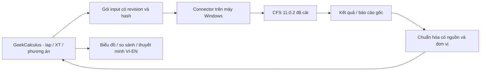

# Kế hoạch kết nối CFS 11.0.2 — GeekCalculus Z purlin

Ngày: 2026-10-18. Baseline CFS rà soát ban đầu: `8c07d65`; đã đồng bộ `main` tới `a658a65` và xác nhận các file CFS liên quan không đổi. **Đây là kế hoạch triển khai, chưa phải tính năng đã hoàn thành hoặc bằng chứng đã kết nối CFS thật.**

**Cập nhật bộ mẫu:** đã nhận và đối chiếu CFSA, ba CFSS và PDF chín trang tại baseline `bfeb4be`; xem [kết quả P0-A](CFS-P0-REVIEW.md). PDF có text layer, input/tổ hợp và một Member Check, nhưng không có biểu đồ/bao moment hay bảng moment theo station. P0-A artifact review đã làm; khảo sát khả năng xuất result/điều khiển CFS và nghiệm thu Windows còn mở. P1 có thể bắt đầu với subset input/combination/localized-check; không được dựng bao moment từ check đơn lẻ. Bảng hiện trạng dưới đây mô tả baseline phần mềm trước khi nhận bộ mẫu, chưa phải tính năng mới đã triển khai.

## 1. Mục tiêu và phân chia trách nhiệm

**CFS 11.0.2 tính toán; GeekCalculus chỉnh phương án, trình bày kết quả và xuất thuyết minh VI/EN.**

- CFS sở hữu mô hình phân tích, độ cứng vùng lap, tải/trường hợp/tổ hợp, nội lực, chuyển vị và kiểm tra thiết kế theo cấu hình thực tế của CFS.
- GeekCalculus cho chỉnh nhanh lap trái/phải và điều kiện biên trong phạm vi đã kiểm chứng; hiển thị sơ đồ, tải, bao moment và kết quả CFS theo cùng một phương án; so sánh phương án và lập thuyết minh.
- Không viết solver dầm hay bộ công thức sức kháng CFS thay thế. Không chuyển module này sang AISC 360-10 chỉ vì website đã có thư viện AISC.
- Giữ module portable, chưa cần Laravel/database. Đơn vị trình bày mục tiêu: m, kN, kN/m, kN·m và đơn vị chuyển vị ghi rõ; chỉ chuyển đổi sau khi xác minh dữ liệu nguồn.

## 2. Hiện trạng được xác nhận từ repository

| Nội dung | Hiện có | Khoảng trống cần xử lý |
| --- | --- | --- |
| Nhập mô hình | [CFSA reader](../structural-platform/frontend/vue/public/cfs-lapping-node/python/cfsa_reader.py) đọc binary layout đã quan sát: member, support, loading | Chưa xác nhận đầy đủ bằng mô hình thật CFS 11.0.2; không có hợp đồng định dạng chính thức trong repo |
| Chuẩn hóa | [Adapter](../structural-platform/frontend/vue/public/cfs-lapping-node/python/adapter.py) giữ native fields và tọa độ quy đổi tạm | Inch → m và support code 7/5 còn provisional; đơn vị tải native chưa xác minh |
| Tổ hợp | Giữ nguyên opaque block và hash khi xuất CFSA | Chưa đọc tên, loại, hệ số, quan hệ case/combo; không được tự đoán từ block này |
| Section | Resolve tên/file `.cfss` trong SECTIONS | Chưa phân tích tính chất và cấu hình design trong CFSS |
| Chỉnh sửa | Lap, XT và exporter bản sao thử nghiệm | Cần mở/chạy lại bằng CFS thật; không chứng minh độ cứng hoặc design của lap từ hình vẽ |
| Runtime | Python parser chạy trong browser qua Pyodide; nguyên bản bốn module portable | Không chứa CFS engine; chưa có kết nối chạy CFS desktop |
| Kết quả/thuyết minh | Chưa có reader kết quả, bao moment hay report CFS | Chưa có mẫu report/bảng số liệu thật, API/CLI/export capability được xác nhận |

[Hướng dẫn module hiện tại](../structural-platform/frontend/vue/CFS-LAPPING-NODE.md) và [manifest nguồn](../structural-platform/frontend/vue/public/cfs-lapping-node/upstream-manifest.json) là bằng chứng baseline. ZIP portable đã dùng có SHA-256 `9f7e542ef1703d7320b90de6bd7cf795d83c5336cff70bd4355dca2fdff56456`; bộ test trước dùng fixture tổng hợp, chưa thay cho nghiệm thu với CFS thật. Chữ `Đơn vị: m- kN` đang có trên UI không xác nhận đơn vị native.

**Đầu ra người dùng xác nhận ngày 2026-10-18: có báo cáo PDF hoặc in báo cáo từ CFS.** PDF thực tế đã nhận có text selectable và bảng input/combination/localized-check; không chứa bảng moment theo station hoặc đồ thị moment. Vì vậy P0/P1 bắt đầu bằng PDF/report thực tế, còn khả năng xuất các bảng result riêng và điều khiển tự động vẫn cần khảo sát. Chuẩn nguồn của mẫu là AISI S100-16/S1-18, US, LRFD.

Chưa có bằng chứng CFS 11.0.2 cung cấp COM, API, CLI, CSV/Excel hay result database. Các phương thức này là đối tượng khảo sát, không phải giả định triển khai. CFS không phải CSI/SAP2000; không tái sử dụng scaffold CSI như thể đã có API CFS.

Main mới có connector SAP2000 thật trong [member-forces connector](../structural-platform/engineering/structural_engine/member_forces/connector.py), dùng loopback, token và origin allowlist. Có thể tham khảo mẫu transport/đóng gói đã có khi làm P5, nhưng phần product adapter, khả năng chạy analysis và bằng chứng Windows phải xác minh riêng cho CFS. Kế hoạch này không sửa hoặc cam kết lại khả năng của session SAP2000.

## 3. Hai mức kết nối

### Mức A — Trao đổi file, triển khai trước

1. Mở/lưu và chạy mô hình gốc trong CFS 11.0.2.
2. Xuất các bảng/report mà phiên bản này thực sự hỗ trợ; nhập vào GeekCalculus qua file picker.
3. GeekCalculus kiểm tra đơn vị, trục/dấu, member, station, case/combo, phiên bản và sự tương ứng input–result trước khi hiển thị.
4. Chỉnh lap/XT → tạo candidate CFSA mới → mở/chạy lại trong CFS → nhập kết quả candidate → so sánh và xuất thuyết minh.

Mức này dùng được với web tĩnh nếu đã có file kết quả phù hợp, không đòi hỏi DB. Nếu chỉ có báo cáo PDF, làm reader báo cáo/bảng có kiểm chứng trước; PDF chỉ chứa hình biểu đồ không đủ để cam kết có đường bao số chính xác. Khi chưa lấy được station values/cực trị đáng tin cậy, đánh dấu thiếu và chưa nghiệm thu bao moment tương tác. Không suy nội lực từ CFSA input hoặc OCR một hình để coi là kết quả chính xác.

**Nhánh PDF-first được chọn theo phản hồi người dùng:** kiểm tra text layer, bảng, số trang và các biểu đồ; ưu tiên đọc text/bảng native. Giữ page/row locator để đối chiếu và có màn hình xác nhận dữ liệu trích xuất. PDF scan/OCR cần kiểm tra từng trường kỹ thuật trước khi dùng; dấu âm, dấu thập phân, số mũ và đơn vị không được tự sửa theo phỏng đoán. Chỉ có bảng cực trị thì trình bày cực trị, không dựng toàn bộ đường cong từ vài điểm. Có thể hoàn thành thuyết minh phạm vi dữ liệu sẵn có trước bao moment đầy đủ; phạm vi thiếu phải hiện rõ, không gọi là report design hoàn chỉnh.

### Mức B — Windows Connector, sau khi nghiệm thu Mức A

- Chọn adapter theo bằng chứng: API/CLI được hỗ trợ nếu có; hoặc cách xuất file qua desktop đã kiểm chứng. UI automation chỉ là nhánh sau cùng, có phát hiện dialog/lỗi và kiểm tra hoàn tất; không mặc định khả thi trước khảo sát.
- Connector chạy ở Windows có CFS, không đặt CFS `.exe` vào Linux Docker/Section Engine. Docker web hiện tại không tự cung cấp CFS.
- Bước đầu ưu tiên connector nhận job và trả gói kết quả qua file; không phụ thuộc browser gọi localhost. Nếu bổ sung kết nối trực tiếp, thử riêng HTTPS Pages → loopback trên browser mục tiêu, CORS/private-network/mixed-content; có pairing, giới hạn origin, thư mục job và không cung cấp shell/filesystem tùy ý. Giữ trao đổi file làm phương án dự phòng.
- Từng job có thư mục riêng, timeout/cancel, log và output mới; xác minh CFS đã kết thúc tính thành công. Không lấy report cũ còn trên ổ đĩa làm output mới. Không ghi đè mô hình gốc.

## 4. Hợp đồng dữ liệu đề xuất

Một **run package** portable gồm manifest, snapshot input chuẩn hóa, các bảng kết quả và report gốc khi có. Không dùng JSON Draft hiện tại như một file kết quả CFS; bổ sung schema/package riêng, giữ tương thích draft v1. Tên file dưới đây là định dạng GeekCalculus đề xuất, không phải định dạng export đã biết của CFS.

| Nhóm | Nội dung bắt buộc hoặc trạng thái thiếu rõ ràng |
| --- | --- |
| `manifest.json` | schema/adapter version, `run_id`, revision/candidate ID, CFS product/version/build, thời gian chạy, trạng thái chạy, solver/design settings, hash từng artifact và nguồn từng bảng |
| Input identity | SHA-256 chính CFSA đã đưa vào CFS, từng CFSS được dùng, các cấu hình/nguồn ngoài ảnh hưởng kết quả; snapshot sau các thay đổi CFS thực sự lưu; hash input chuẩn hóa gắn với revision UI |
| `model.json` | Members/sections, gối, springs/restraints, liên kết, spans/overhangs, lap extents, local axes và quy tắc tọa độ; mapping ID CFS ↔ ID UI; unknown flags/codes giữ nguyên và chặn nhánh phụ thuộc |
| `loads.json` | Tên/ID case, loại/chiều tải, vị trí/miền tải, trị số, hệ số riêng, self-weight và pattern loading nếu có; ghi rõ force/line-load/moment, đơn vị native lẫn normalized |
| `combinations.json` | ID/tên, case/combo references và factors, ULS/SLS/design/analysis category theo nguồn; giữ nonlinear/envelope semantics, không tự phân phối/superpose khi không được phép |
| `results.json` | Theo run/member/case hoặc combo: station, local/global x, phía trái/phải tại discontinuity, component/dấu, moment/shear/axial/torsion/deflection/reaction khi có; sampled curve và solver-reported extrema phân biệt |
| `design.json` | Check name nguyên bản, member/segment/station, combo chi phối, demand/capacity/ratio và units khi nguồn cung cấp, method/code/options, CFS status và cảnh báo; không điền 0 cho check thiếu |
| Nguồn báo cáo | Artifact hash, trang/bảng/dòng hoặc ID record, text gốc, raw numeric strings và mức độ trích xuất/kiểm chứng; không cần công khai file dự án lên Git/Pages |

`input_fingerprint` phải bao phủ geometry/lap, support/bracing/spring, section/material, loads/combinations, CFS version và tất cả analysis/design settings ảnh hưởng kết quả. Hash bao gồm mapping canonical/version của normalizer; output hashes giữ riêng, tránh tự tham chiếu manifest. Nếu chưa thu đủ input identity, trạng thái là `unverified`, không phải `matched`.

Luôn giữ native value/unit và phép chuyển đổi đã xác minh bên cạnh normalized value. Kiểm tra tên case trùng, ID thay đổi, references thiếu, NaN/Infinity và station ngoài miền. Khả năng đọc từng component độc lập: thiếu design không cấm xem moment đã kiểm chứng, nhưng cấm báo cáo design hoàn chỉnh.

## 5. Biểu đồ bao moment và thao tác lap

### Bố cục đề xuất

- Một trục X chung cho sơ đồ member/gối/XT, vùng lap tô màu và biểu đồ moment bên dưới; giữ overhang/toạ độ âm. Trường hợp lap gồm hai member chồng nhau, cho chọn kết quả từng member; không cộng hoặc chia moment giữa chúng bằng giả thiết của UI.
- Bộ chọn `Run / Phương án`, `Case / Combination / Envelope`, moment component, đơn vị và nhóm tổ hợp ULS/SLS. Legend giải thích rõ dấu của CFS và phía vẽ moment.
- Hai đường bao trên/dưới; hover hiện member, station, trị số, combo chi phối và nguồn kết quả. Click cực trị chọn vùng tương ứng trên sơ đồ; drag/numeric editor chỉnh lap trái/phải với bước và giới hạn cấu tạo được khai báo.
- Baseline/candidate có màu khác nhau, gắn run/revision. Chỉ so sánh định lượng khi đơn vị, trục, phạm vi tổ hợp và settings tương thích; khác biệt input được liệt kê.

### Quy tắc số liệu

Với tập tổ hợp đã chọn và dữ liệu moment có thể đối chiếu ở cùng member/axis/station:

`M_upper(x) = max M_c(x)` và `M_lower(x) = min M_c(x)`.

Hai đường là giới hạn trên/dưới có dấu, không ép một đường luôn dương hoặc luôn âm. Lưu combo chi phối và xử lý đồng chi phối. Ưu tiên envelope/cực trị do CFS xuất; nếu GeekCalculus lập bao từ bảng số, ghi rõ đó là tổng hợp từ kết quả CFS với tập tổ hợp, sampling và phương pháp được khai báo.

Không coi bao là một trường hợp tải có thật; combo chi phối có thể đổi theo station. Không lấy moment max từ tổ hợp A ghép shear/axial max từ B để tự tính design ratio. Kết quả interaction/design giữ đúng combo và check của CFS.

Station ở hai phía gối/tải tập trung/đầu lap phải được phân biệt; không nối qua khoảng không có kết quả hoặc áp nội suy làm mất discontinuity. Với lưới station khác nhau, phải có quy tắc nội suy trong từng đoạn liên tục đã kiểm chứng, hoặc yêu cầu xuất lại lưới chung; không mặc định đường cong trơn là kết quả chính xác. Phân biệt cực trị tại mẫu với cực trị solver; tooltip xuất đúng dữ liệu, đường vẽ không làm overshoot.

### Khi chỉnh lap

1. Hình học và vùng lap cập nhật tức thời, trạng thái chuyển sang `modified`.
2. Kết quả cũ chỉ còn là baseline tham khảo có nhãn `stale — cần chạy lại CFS`; không gắn chúng như kết quả candidate mới.
3. Người dùng bấm `Run in CFS / Chạy CFS` khi connector có thật, hoặc xuất candidate và nhập kết quả sau khi chạy thủ công. Có thể debounce chạy tự động ở mốc sau; phản hồi kết quả đến muộn không được gán cho revision mới hơn.
4. Chỉ gắn `matched` khi input fingerprint và run checks khớp; lỗi/hủy/incomplete/missing units không thay thế run hợp lệ trước đó.
5. Báo cáo cuối chỉ sử dụng snapshot đã khớp, hoàn tất và đủ dữ liệu cho phạm vi báo cáo; không tự lấy bảng từ nhiều run.

`draft → exported → awaiting_CFS → running (nếu có connector) → imported → validated/matched` là vòng đời dự kiến; `stale`, `failed`, `cancelled`, `unverified` là trạng thái riêng. Không giả lập trạng thái chạy khi chỉ xuất file.

### Ý nghĩa tối ưu

Bản đầu hỗ trợ **tối ưu trực quan có người quyết định**: so chiều dài/tổng khối lượng lap nếu có dữ liệu, moment demand, CFS utilization, deflection và các kiểm tra liên quan được CFS cung cấp. Vị trí moment bằng 0 chỉ là thông tin tham khảo, không tự xác định chiều dài lap tối ưu. Lap có thể thay đổi độ cứng/phân phối nội lực; sức kháng, tương tác, buckling, bearing/web crippling, liên kết/khả năng truyền lực và cấu tạo không được suy từ biểu đồ moment đơn thuần. Kiểm tra nào CFS không bao phủ phải liệt kê riêng.

Quét lưới/search nhiều phương án chỉ làm sau: mỗi candidate chạy CFS thật, ràng buộc cấu tạo/phạm vi và hàm mục tiêu rõ ràng, budget/cancel, cache theo toàn bộ input fingerprint. Chỉ gọi là tốt nhất **trong tập phương án đã tính và bộ kiểm tra khai báo**, không khẳng định tối ưu toàn cục.

## 6. Thuyết minh tự động VI/EN

Tạo report từ đúng một run đã chọn; hỗ trợ VI, EN hoặc song song VI/EN. Bản đầu xuất HTML có print stylesheet để lưu PDF trong browser; Word/DOCX là mốc sau nếu cần.

1. Thông tin công trình/mô hình, revision, CFS 11.0.2 build, code/method/settings và nguồn dữ liệu.
2. Tiết diện/vật liệu, sơ đồ tính/gối/giằng, lap trái/phải và các giả thiết CFS ghi nhận.
3. Bảng tải, case/tổ hợp, đơn vị và quy ước trục/dấu đã xác minh.
4. Biểu đồ moment và các nội lực/chuyển vị/phản lực có dữ liệu; ghi tập combo và cực trị/nhánh chi phối.
5. Bảng design theo member/segment, check nguyên bản, demand/capacity/ratio/combo và kết luận **do CFS trả về**, giới hạn đủ/thiếu của dữ liệu trích xuất.
6. So sánh baseline/candidate nếu có hai run hợp lệ; không gom thành một bộ kết quả đồng thời.
7. Cảnh báo/kiểm tra ngoài phạm vi, nguồn bảng/trang, danh mục file/hash; đính kèm hoặc liên kết bản report CFS gốc trong gói tải về khi được chọn.

Giữ text gốc CFS song song với nhãn dịch từ glossary có version. Đổi VI/EN chỉ đổi cách trình bày và format số, không đổi trị số, công thức, hệ số, tên case/combo hoặc danh tính check. Công thức chỉ trình bày khi có nguồn đã đối chiếu; không tạo thêm bước tính rồi ghi như nội dung gốc CFS. Thiếu dữ liệu ghi `Không có trong nguồn / Not provided`, không suy thành PASS/0. CFS-reported PASS/FAIL và mức độ đầy đủ/xác minh của GeekCalculus là hai trường riêng. Lỗi extraction hoặc thiếu check phải hiện trong report.

MVP không dịch tự do bằng AI các điều kiện/công thức design. Glossary kỹ thuật được rà soát một lần; report gốc và record locator giúp đối chiếu. Số chính xác lưu nội bộ; làm tròn và dấu thập phân theo locale chỉ ở lớp hiển thị.

## 7. Packages, phụ thuộc và nghiệm thu

| Package | Việc thực hiện | Nghiệm thu / điều kiện chuyển bước |
| --- | --- | --- |
| **P0 — Khảo sát CFS thật** | Bắt đầu từ PDF/in report người dùng đã xác nhận; kiểm tra text/bảng/biểu đồ và menu/export/help/API/CLI của đúng 11.0.2; lập capability matrix; tạo bộ mẫu gốc và hai biến thể chỉ đổi lap/XT; hiệu chuẩn units/axes/support codes, load categories, design settings | Có file input/section và report/bảng thật khớp nhau, ảnh cấu hình, hash/version, bản ghi mở–tính–xuất; quyết định có đủ dữ liệu số cho bao moment và đường chạy lại nào khả thi. Nếu chỉ có hình, chưa cho qua yêu cầu bao số |
| **P1 — Result reader & schema** | PDF text/table reader trước; parser bảng số riêng nếu khảo sát tìm được; schema run package, mapping member/case/combo/station, provenance/fingerprint, native/normalized units | Đối chiếu bảng độc lập với CFS ở gối/nhịp/đầu lap và cực trị; sai units/version/reference/stale/missing fields bị nhận diện. Giữ CFSA/CFSS gốc nguyên vẹn; không coi OCR chưa duyệt là dữ liệu đã xác minh |
| **P2 — Moment workspace** | Overlay hình học/lap/bao moment, case/combo selector, tooltip/cực trị, baseline/candidate và stale state | Cùng station/combo/đơn vị cho cùng giá trị CFS; lap/XT edit lập tức stale; không giả chạy lại; kiểm tra dấu/overhang/discontinuity/member chồng nhau và mobile/VI/EN |
| **P3 — Vòng lặp thủ công** | Xuất candidate, mở/tính lại CFS, nhập result, kiểm tra input identity và so sánh phương án | Hai candidate với thay đổi lap/XT đã mở/chạy thật; CFS đọc đúng input; mọi load/combo/section không chủ đích thay đổi được giữ; report cũ/sai candidate bị từ chối gắn vào revision hiện tại |
| **P4 — Report VI/EN** | Glossary, report template, snapshot và HTML/Print PDF từ dữ liệu gốc CFS | Report VI/EN cùng số/check/combo/run, đối chiếu được tới report gốc; bản thiếu design không xuất như báo cáo design đầy đủ. Bao gồm toàn bộ cảnh báo nguồn, font/ký hiệu và page breaks hợp lý |
| **P5 — Windows Connector** | Đóng gói worker/adapter điều khiển theo capability P0, job queue, trạng thái/log/timeout, trả run package | Một lệnh từ workflow thực sự chạy CFS và trả input-matched result; xử lý dialog/lỗi/cancel, output cũ, response lệch revision, hai job; browser–local transport kiểm thử riêng hoặc tiếp tục file exchange |
| **P6 — Tìm phương án có hỗ trợ** | Quét lap theo giới hạn; so utilization/serviceability/cost trong phạm vi khai báo | Mọi ứng viên có CFS run thật; cùng settings/combo set để so, trường hợp thiếu check không tự chọn thắng; kết quả tái lập và có bảng ứng viên/nguồn. Đây là mốc sau MVP |

**Thứ tự khuyến nghị: P0 → P1 → P2 → P3 → P4 → P5; P6 sau cùng.** P4 template và bản report phạm vi hạn chế có thể chuẩn bị sau P1 nếu PDF chỉ đủ cho báo cáo, nhưng nghiệm thu report cuối cần kết quả đã khớp từ P3. P2 cung cấp giá trị trực quan sớm khi có bảng moment; P3+P4 là MVP vận hành không cần tự động hóa CFS. Chưa ước lượng lịch chắc chắn trước P0 vì khả năng xuất kết quả và điều khiển CFS quyết định phần lớn độ khó.

### Bộ mẫu kiểm chứng

- Mô hình đơn giản có lời giải/reference độc lập để kiểm tra mapping dấu/đơn vị; mô hình nhiều nhịp có lap và gravity/uplift, tải bất đối xứng/pattern; thêm overhang và case chi phối thay đổi nếu CFS hỗ trợ.
- Baseline và hai biến thể chỉ đổi một yếu tố; một biến thể đổi lap, một biến thể đổi XT để chứng minh cần tính lại. Có ít nhất một kết quả design fail hoặc cảnh báo để kiểm tra việc giữ nguyên ý nghĩa.
- So source tables với normalized tables và UI/report; tolerance theo độ chính xác file xuất/làm tròn của CFS, thống nhất sau P0, không áp một tolerance chung cho mọi trường. Đối chiếu engineering độc lập riêng với kiểm thử parser.
- Tests âm: thiếu combo/member/section/settings, ID trùng, unit/sign chưa xác minh, truncated/corrupt input, kết quả run khác, timestamp mới nhưng input cũ, nhảy dấu/cực trị giữa station, thiếu design và job CFS lỗi. Fixture tổng hợp chỉ kiểm tra phần mềm; phải có product read-back thực tế trước tuyên bố tích hợp hoàn chỉnh.

## 8. Phạm vi mã nguồn và bước tiếp theo

Đề xuất khi bắt đầu coding, không tạo các thư mục này chỉ để hoàn tất tài liệu:

- Giữ entry Vue và standalone studio hiện tại trong `structural-platform/frontend/vue`; module result reader/viewer/report tách khỏi bốn Python core gốc; không sửa thuật toán binary để đọc result khi chưa có đặc tả thật.
- Hợp đồng/parser portable đề xuất trong `structural-platform/cfs-integration/`; Windows runner riêng trong `structural-platform/cfs-connector/`, không lẫn `csi-agent` hoặc `engineering/structural_engine`.
- Fixture/parser/browser tests mở rộng từ `structural-platform/tests/cfs/` và `tests/cfs-portable-smoke.cjs`; golden samples chỉ dùng dữ liệu tổng hợp/được phép công khai. File công trình/report thực giữ ngoài Git/Pages.
- Không thêm migration/Laravel service/database trong MVP này. Không thay các module Steel/RC/Loading hiện có hoặc build Section Engine để chạy CFS.

**Đầu vào P0 đã nhận:** mô hình `.cfsa`, đủ ba `.cfss` được tham chiếu và PDF báo cáo chín trang. Đã đối chiếu offline geometry/supports/displayed loads và đọc tổ hợp/check của nguồn; chưa có kết quả moment dọc dầm, complete design summary, ảnh menu/cấu hình hoặc môi trường Windows CFS để xác nhận vòng lặp thật. Các artifact thực và dữ liệu trích xuất giữ ngoài Git/Pages. Không thể coi toàn bộ P0 hoặc nghiệm thu kết nối thật là đã đạt.

Hành động tiếp theo: triển khai P1-A cho **CFSA + PDF input/combination/localized-check → run package** với provenance và coverage rõ ràng; đồng thời lấy bằng chứng menu/report result từ CFS để xác định nguồn moment. Chỉ bắt đầu nghiệm thu P1-B/P2 một moment component và một nhóm tổ hợp khi thực sự có số liệu moment theo station/cực trị thích hợp.
